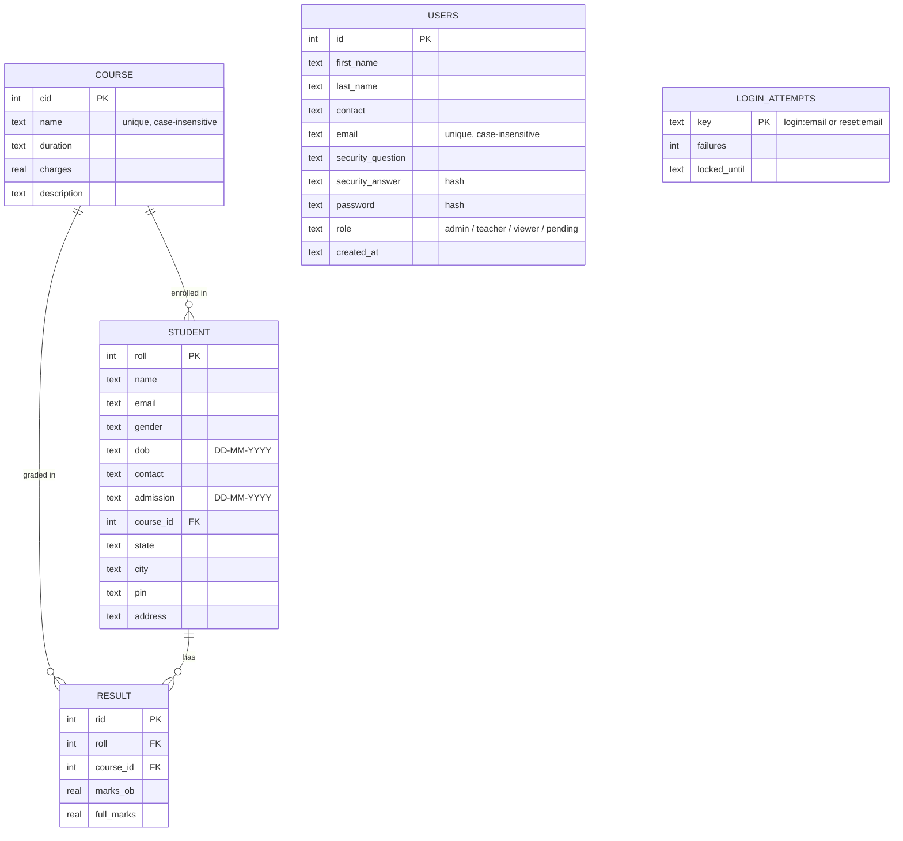

# 🎓 Student Result Management System (SRMS)

[](https://github.com/gauravkumar-codes/SRMS/actions/workflows/tests.yml)


A desktop application for managing courses, students and exam results, with secure
login, role-based access control and an admin screen for approving users.
Built with **Python, Tkinter and SQLite**.

---

## 📑 Table of contents

- [Features](#-features)
- [Screenshots](#-screenshots)
- [Tech stack](#-tech-stack)
- [Getting started](#-getting-started)
- [First run](#-first-run)
- [Roles and permissions](#-roles-and-permissions)
- [Security design](#-security-design)
- [Database design](#-database-design)
- [Project structure](#-project-structure)
- [Running the tests](#-running-the-tests)
- [Building a standalone app](#-building-a-standalone-app)
- [Interview questions and answers](#-interview-questions-and-answers)
- [Troubleshooting](#-troubleshooting)
- [Known limitations and roadmap](#-known-limitations-and-roadmap)
- [Contributing](#-contributing)
- [License](#-license)

---

## ✨ Features

**Accounts and security**
- Registration, login and "forgot password" using a security question
- Passwords and security answers stored as salted **scrypt** hashes (never plain text)
- Account lockout after repeated failed attempts (login and password reset)
- Login errors that do not reveal whether an email is registered
- Live password-strength hint and a password policy that rejects weak or common passwords

**Access control**
- Three roles (**Admin**, **Teacher**, **Viewer**) plus a **Pending** state for new sign-ups
- First registered account becomes Admin; everyone else needs admin approval
- Permissions are enforced in the code that changes data, not only by hiding buttons
- Admin screen to approve users, change roles, unlock accounts and delete users

**Academic data**
- **Courses:** add, edit, delete and search, with duration, fee and description
- **Students:** full profile (contact, date of birth, address, course), search by roll number or name
- **Results:** pick a student, enter marks, see the percentage live before saving
- **View results:** search by roll number and see every result for that student, with delete
- Input validation for email, phone, PIN code, dates and numbers

**Dashboard**
- Live analog and digital clock, a welcome banner and live totals for courses, students and results
- Personal greeting with your name and role
- One window per module (clicking a button again brings the existing window forward)

---

## 🖼 Screenshots

Add your own screenshots to a `docs/screenshots/` folder and uncomment the lines below.

<!--
| Login | Dashboard |
|---|---|
|  |  |

| Students | View result |
|---|---|
|  |  |
-->

---

## 🧰 Tech stack

| Part | Choice |
|---|---|
| Language | Python 3.8 or newer |
| GUI | Tkinter (with `ttk` for tables and drop-downs) |
| Images | Pillow |
| Database | SQLite (`sqlite3` from the standard library) |
| Password hashing | `hashlib.scrypt` (standard library) |
| Tests | `unittest` (standard library) |

The only third-party package is **Pillow**.

---

## 🚀 Getting started

### Prerequisites

- Python **3.8+** with Tkinter (included with the Windows and macOS installers from
  python.org; on Linux see [Troubleshooting](#-troubleshooting))
- Git (only if you want to clone the repository)

### Install and run

```bash
# 1. Get the code
git clone https://github.com/gauravkumar-codes/SRMS.git
cd SRMS

# 2. (Recommended) create a virtual environment
python -m venv .venv
# Windows:        .venv\Scripts\activate
# macOS / Linux:  source .venv/bin/activate

# 3. Install the dependency
pip install -r requirements.txt

# 4. Start the app
python main.py
```

### Pictures (optional)

The app looks for these files in an `images/` folder next to `main.py`:

| File | Used on |
|---|---|
| `b2.jpg` | Login and registration background |
| `side.jpg` | Left panel of login and registration |
| `logo_p.jpg` | Dashboard header logo |
| `bg_img.jpg` | Dashboard banner |
| `result.jpg` | Result entry screen |

Every image is optional. If one is missing, the app still starts and uses a plain
colour or an icon instead.

---

## 🏁 First run

When you start the app, `main.py` prepares the database automatically:

- **No database yet:** a new `rms.db` is created.
- **Database from an older version:** it is upgraded in place, and a backup is saved
  first as `rms.db.bak-v1`. Existing users keep their current passwords (they are
  converted to hashes). The oldest account becomes **Admin** and the others become
  **Viewer**, so nobody silently keeps full access.

### Creating the first admin

1. Click **Register** on the login screen and create an account.
2. Because it is the first account, it is made **Admin** automatically.
3. Log in. Anyone who registers after that stays **Pending** until an admin approves
   them under **Users** on the dashboard.

There is no built-in default password, so there is nothing to change before
publishing the project.

---

## 🔐 Roles and permissions

| Action | Admin | Teacher | Viewer | Pending |
|---|:-:|:-:|:-:|:-:|
| Log in | ✅ | ✅ | ✅ | ❌ (awaiting approval) |
| View courses | ✅ | ✅ | ✅ | – |
| Add / edit / delete courses | ✅ | ❌ | ❌ | – |
| View students | ✅ | ✅ | ✅ | – |
| Add / edit students | ✅ | ✅ | ❌ | – |
| Delete students | ✅ | ❌ | ❌ | – |
| View results | ✅ | ✅ | ✅ | – |
| Add results | ✅ | ✅ | ❌ | – |
| Delete results | ✅ | ✅ | ❌ | – |
| Manage users (approve, roles, unlock, delete) | ✅ | ❌ | ❌ | – |

Rules to know:
- Menu buttons a role cannot use are hidden.
- Every write action also re-checks the user's **current role in the database**, so
  demoting or deleting someone takes effect on their very next action.
- You cannot change or delete your own account, and the last administrator cannot be
  demoted or deleted.

The full list lives in `PERMISSIONS` in `auth.py`.

---

## 🛡 Security design

| Topic | What the project does |
|---|---|
| Password storage | Salted **scrypt** hash with a random salt per password; the cost settings are stored with the hash so they can be raised later |
| Security answers | Lower-cased and trimmed, then hashed the same way |
| Comparison | Constant-time (`hmac.compare_digest`) |
| Brute force | 5 failed attempts lock an email for 5 minutes. Login and reset have separate counters. Lock state is kept per email, so unknown emails lock too |
| Account enumeration | Wrong password and unknown email give the same message and take the same time; the reset form shows a stable, plausible question for unknown emails |
| SQL injection | Every query uses `?` placeholders; user text in searches is escaped so `%` and `_` are literal |
| Email handling | Stored lower-case; unique case-insensitively |
| Authorization | Role checked in the data-changing code and re-read from the database each time |

> **Honest scope note:** this is a learning project for a desktop app. Security
> questions are a weak recovery method; production systems should use a single-use,
> expiring reset link sent by email. See [Roadmap](#-known-limitations-and-roadmap).

---

## 🗄 Database design

SQLite file `rms.db` (schema version 2). Foreign keys are switched on for every
connection.



Integrity rules:
- Deleting a **student** also deletes that student's results (cascade).
- Deleting a **course** that students or results still use is refused (restrict).
- A student can have **one result per course** (`UNIQUE (roll, course_id)`).
- `0 <= marks_ob <= full_marks` and `full_marks > 0` are enforced by the database.
- The **percentage is calculated** when needed, never stored.

---

## 🗂 Project structure

```
.
├── main.py                 # entry point; prepares the DB and runs the screen loop
├── auth.py                 # login, registration, reset, roles, lockout, user admin
├── security.py             # scrypt hashing helpers
├── validators.py           # input validation and formatting
├── db.py                   # connections, schema, one-time upgrade from old versions
├── config.py               # file locations (works for scripts and packaged builds)
├── theme.py                # colours, fonts and ttk styles
├── widgets.py              # shared buttons, entries, cards, permission gate
├── login.py                # login screen
├── register.py             # registration screen
├── forget_password.py      # password reset window
├── dashboard.py            # main window with clock, stats and navigation
├── course.py               # course management
├── student.py              # student management
├── result.py               # result entry
├── report.py               # result viewer
├── users.py                # admin-only user management
├── create_db.py            # optional manual database setup
├── requirements.txt
├── images/                 # optional pictures (not included)
└── tests/
    ├── test_core.py        # security, validation, migration, auth, roles
    ├── test_gui_smoke.py   # drives every screen with a stand-in tkinter
    └── fake_tk.py          # the stand-in used by the smoke tests
```

How the screens connect: `main.py` runs a loop. Each screen stores where to go next
in `next_screen` and closes itself; the loop then opens the next one. There is only
ever one Tk root, and the screens never import each other.

---

## 🧪 Running the tests

```bash
python -m unittest discover -s tests -v
```

- `test_core.py` covers hashing, validators, upgrading an old database (including
  messy rows), foreign keys, registration, uniform login errors, lockout and its
  expiry, password reset and the permission rules.
- `test_gui_smoke.py` runs every screen's logic for all three roles using a small
  stand-in for Tkinter, so it works on machines without a display (this is what the
  GitHub Actions workflow uses).

The smoke tests check behaviour, not appearance. Always run the real app once to
check layout and colours.

---

## 📦 Building a standalone app

To give the app to people who do not have Python, build it with PyInstaller:

```bash
pip install pyinstaller
pyinstaller --noconfirm --windowed --name SRMS --add-data "images;images" main.py
```

On macOS or Linux use `--add-data "images:images"` (a colon instead of a semicolon).
The result is in `dist/SRMS/`; zip that folder and attach it to a GitHub Release.

- Build on the operating system you are targeting; PyInstaller cannot cross-compile.
- The database `rms.db` is created next to the program, so users keep their data.
- Test the built app on a clean machine before publishing it.

---

## 🎤 Interview questions and answers

Questions an interviewer is likely to ask about this project, with short answers based
on how it is actually built. Click a question to open the answer. Use your own words
when you answer; the file names tell you where to point in the code.

### About the project

<details>
<summary><b>1. Give me a 30-second overview of your project.</b></summary>

A desktop Student Result Management System in Python with Tkinter and SQLite. Staff
log in, manage courses and students, enter marks and view results. The main focus is
security: hashed passwords, account lockout, and role-based access (Admin, Teacher,
Viewer) with an approval step for new users. It has an automated test suite and
upgrades older databases automatically.
</details>

<details>
<summary><b>2. Why Tkinter and SQLite?</b></summary>

Both ship with Python, so there is nothing to install or host, which suits a
single-computer tool. SQLite is a file-based database that needs no server. The trade-off
is that SQLite is not meant for many users writing at the same time; for that I would
move to MySQL or PostgreSQL. Because the SQL is confined to `db.py`, `auth.py` and the
screens that own the data, that move would be manageable.
</details>

<details>
<summary><b>3. How is the code organised?</b></summary>

By responsibility. `auth.py` holds every security decision, `security.py` does the
hashing, `validators.py` holds input rules, `db.py` owns connections and the schema,
and `theme.py` / `widgets.py` hold the shared look. The screens (`login.py`,
`student.py` and so on) only collect input and show results. This keeps rules in one
place, so they cannot drift apart between screens.
</details>

<details>
<summary><b>4. What was the hardest problem you solved?</b></summary>

Good answers from this project: upgrading an existing database without losing data
(rename old tables, create the new schema, copy and convert rows, back up first, all in
one transaction); or designing login so it does not reveal which emails exist while
still locking out guessers. Pick one you can explain step by step.
</details>

<details>
<summary><b>5. What would you improve if you had more time?</b></summary>

Email-based expiring reset links instead of security questions, an audit log of who
changed or deleted what, an idle timeout, export to PDF/Excel, and a web version
(Flask or Django) that reuses the non-GUI modules. See the roadmap above.
</details>

### Authentication

<details>
<summary><b>6. What is the difference between authentication and authorization?</b></summary>

Authentication proves who you are (email and password). Authorization decides what you
may do once you are known. Here, `authenticate()` in `auth.py` is authentication;
the `PERMISSIONS` table plus `can()` / `can_now()` and `require_permission()` are
authorization.
</details>

<details>
<summary><b>7. How do you store passwords, and why?</b></summary>

As salted scrypt hashes, never plain text. If the database file leaks, attackers get
hashes, not passwords. Each password has its own random 16-byte salt, so two users with
the same password get different hashes and precomputed (rainbow) tables are useless.
The stored string also records the scrypt settings (`scrypt$16384$8$1$salt$key`), so the
cost can be raised later and old hashes still verify.
</details>

<details>
<summary><b>8. Hashing vs encryption vs encoding?</b></summary>

Hashing is one-way: you cannot get the original back, you can only check a guess.
Encryption is two-way with a key. Encoding (such as base64) is just a format change with
no secrecy. Passwords should be hashed, because the system never needs to read them
back.
</details>

<details>
<summary><b>9. Why scrypt and not MD5 or plain SHA-256?</b></summary>

MD5 and SHA-256 are designed to be fast, which helps attackers who can try billions of
guesses per second. scrypt is deliberately slow and memory-hungry, which makes large-scale
guessing expensive. bcrypt and Argon2 are equally good choices; scrypt was used because
it is built into Python's `hashlib`, so there is no extra dependency.
</details>

<details>
<summary><b>10. What is a salt, and is it secret?</b></summary>

A salt is a random value mixed into each password before hashing. It is not secret; it
is stored with the hash. Its job is to make every hash unique and to stop attackers
reusing precomputed tables. A secret value stored separately would be a "pepper".
</details>

<details>
<summary><b>11. How do you stop brute-force attacks?</b></summary>

After 5 failed attempts the email is locked for 5 minutes (`MAX_ATTEMPTS` and
`LOCK_MINUTES` in `auth.py`). Login and password reset have separate counters. The count
is kept in a `login_attempts` table keyed by email, not on the user row, so an attacker
guessing a non-existent email is locked in exactly the same way. While locked, even the
correct password is refused. A successful login or reset clears the counter.
</details>

<details>
<summary><b>12. What is account enumeration and how do you prevent it?</b></summary>

It is when an attacker learns which emails are registered from different error messages
or response times. Here, a wrong password and an unknown email both return "Invalid
email or password", and for unknown emails the code still computes a dummy hash so the
response takes the same time. The reset form shows a stable but fake security question
for unknown emails instead of an error. A "pending approval" message appears only after
the correct password. Registration does say "already registered", which is hard to avoid
without email verification.
</details>

<details>
<summary><b>13. Why compare hashes with <code>hmac.compare_digest</code>?</b></summary>

A normal `==` stops at the first different character, so how long it takes can leak
information about how much matched. `compare_digest` takes the same time regardless of
where the difference is (a "timing attack" defence).
</details>

<details>
<summary><b>14. How does "forgot password" work, and what are its weaknesses?</b></summary>

The user enters their email, sees their security question, answers it and sets a new
password. The answer is normalised (lower-case, trimmed) and checked against a hash, and
attempts are rate-limited. The weakness is that security questions are guessable or
findable (pet name, birth place). A production system should email a single-use link
that expires, which is on my roadmap.
</details>

<details>
<summary><b>15. What is your password policy?</b></summary>

At least 8 characters with a letter and a number, no very common passwords, and no part
of the user's email name or own name. The register screen shows a live Weak/Fair/Strong
hint. The rules live in `validators.check_password_policy` and are enforced in
`auth.register_user` and `auth.reset_password`, not just in the form.
</details>

### Authorization and roles

<details>
<summary><b>16. How does role-based access control (RBAC) work here?</b></summary>

Every user has one role. `PERMISSIONS` in `auth.py` maps each role to a set of
permission strings such as `student.write` or `result.delete`. Screens check those
strings, never the role name, so changing what a role may do means editing one table.
</details>

<details>
<summary><b>17. Hiding a button isn't security. What do you do instead?</b></summary>

Buttons are hidden only for convenience. Every action that changes data calls
`require_permission()`, which uses `can_now()` to read the user's **current role from the
database** and refuse if the permission is missing. So even if a button were somehow
triggered, the change would be blocked.
</details>

<details>
<summary><b>18. What happens if an admin demotes a user who is logged in?</b></summary>

Their session still holds the old role (used for showing menus), but `can_now()` re-reads
the database on each write, so their next change is refused. A deleted user loses access
the same way.
</details>

<details>
<summary><b>19. How do new users get access? Why is the first user special?</b></summary>

The first registered account becomes Admin so someone can bootstrap the system. After
that, registrations are "Pending" and cannot log in until an admin assigns a role on the
Users screen. The first-user check runs inside `BEGIN IMMEDIATE`, so two registrations at
the same moment cannot both become admin.
</details>

<details>
<summary><b>20. What is the principle of least privilege, and where do you use it?</b></summary>

Give each user only the access they need. New sign-ups start with none (Pending), Viewer
is read-only, only Admin can delete students or change courses, and when an old database
is upgraded, existing users become Viewers except the oldest account.
</details>

<details>
<summary><b>21. Can an admin lock everyone out?</b></summary>

No. You cannot change or delete your own account, and the last remaining admin can be
neither demoted nor deleted (`set_role` and `delete_user` in `auth.py`).
</details>

<details>
<summary><b>22. What are the limits of security in a desktop app?</b></summary>

Whoever can open the `rms.db` file on that computer can edit it directly, for example
change a role. Hashing protects passwords, but not the file as a whole. In a real
deployment the database sits behind a server that enforces these rules, which is another
reason to move to a web app for multi-user use.
</details>

### Database

<details>
<summary><b>23. What is SQL injection, and are you protected?</b></summary>

It is when user input is pasted into a query and changes its meaning, such as typing
`' OR '1'='1`. Every query here uses `?` placeholders, so input is always treated as data.
I found one place that built a query with an f-string (course search) and fixed it. For
`LIKE` searches I also escape `%` and `_` so they match literally.
</details>

<details>
<summary><b>24. What are foreign keys, and why did you turn them on?</b></summary>

A foreign key links a row to a row in another table (a result belongs to a student and a
course). SQLite ignores them unless you run `PRAGMA foreign_keys = ON` on every
connection, which `db.get_conn()` does. With them on: deleting a student deletes their
results (`ON DELETE CASCADE`), and deleting a course that is still used is refused
(`ON DELETE RESTRICT`). This prevents orphaned or inconsistent data.
</details>

<details>
<summary><b>25. Why do students and results store a course id instead of the course name?</b></summary>

If the name is copied everywhere, renaming or deleting a course leaves stale copies.
With an id, the name lives in one place, so a rename updates everywhere and the database
can enforce that the course exists.
</details>

<details>
<summary><b>26. Why is the percentage not stored?</b></summary>

It can be calculated from marks and full marks, and a stored copy can become wrong or
disagree with them (it is a derived value). Calculating it when needed keeps one source
of truth.
</details>

<details>
<summary><b>27. How did you upgrade the old database without losing data?</b></summary>

`db.init_db()` checks `PRAGMA user_version`. If it is older than 2, it copies the file to
`rms.db.bak-v1`, then in a single transaction renames the old tables, creates the new
schema, copies and converts the rows (mapping course names to ids, converting marks to
numbers, hashing old plain-text passwords), and drops the old tables. If anything fails,
the transaction rolls back and the original is untouched. It runs only once.
</details>

<details>
<summary><b>28. What does the <code>get_conn()</code> context manager do?</b></summary>

It opens a connection with foreign keys on, commits if the block succeeds, rolls back if
an exception happens, and always closes the connection. That removes the old problem of
connections left open and half-finished changes.
</details>

<details>
<summary><b>29. When would you choose MySQL or PostgreSQL over SQLite?</b></summary>

When many users must write at the same time, when the data must be accessed over a
network, or when you need stronger user management and backup tooling. SQLite is ideal
for a single-machine app like this one.
</details>

### Design, GUI and testing

<details>
<summary><b>30. How do the screens open each other?</b></summary>

Each screen records where to go next in `next_screen` and closes itself. `main.py` runs a
loop that opens the next screen. This keeps a single Tk root, avoids nested `mainloop()`
calls, and avoids circular imports between login, register and dashboard.
</details>

<details>
<summary><b>31. How do you avoid duplicated GUI code?</b></summary>

Colours and fonts are in `theme.py`; button, entry, card and header builders are in
`widgets.py`; every screen imports them. Changing the look means editing one file.
</details>

<details>
<summary><b>32. How did you test a GUI app?</b></summary>

The important logic (hashing, validation, migration, login, lockout, roles) is separate
from the GUI, so `test_core.py` tests it directly. `test_gui_smoke.py` runs every screen's
logic with a small stand-in for Tkinter (`fake_tk.py`), so it works on machines with no
display, including GitHub Actions. These tests check behaviour and permissions, not how
the windows look, so I also run the real app.
</details>

<details>
<summary><b>33. What did the tests actually catch?</b></summary>

Real mistakes during development, for example the database upgrade reading users from the
wrong table, which would have lost every account. That is a good example of why
migrations need tests with realistic data.
</details>

<details>
<summary><b>34. How is input validated?</b></summary>

In `validators.py`: email format, exactly 10 ASCII digits for phone (so look-alike
Unicode digits are rejected), 6-digit PIN, `DD-MM-YYYY` dates, finite numbers only (no
`nan`/`inf`), marks between 0 and full marks. The database adds its own constraints
(`CHECK`, `UNIQUE`, foreign keys) as a second line of defence.
</details>

<details>
<summary><b>35. What bugs did you find in the original code?</b></summary>

Update showed "success" even when nothing was updated, because the commit and message sat
outside the `else`; course search was open to SQL injection; roll numbers like `007`
could become `7`; empty or non-numeric marks crashed the app; connections were never
closed; and the report showed only one result per student.
</details>

### Deployment and teamwork

<details>
<summary><b>36. Can this be deployed?</b></summary>

Not as a website, because Tkinter runs on the user's computer. It can be shared as source
on GitHub or packaged with PyInstaller into an app people double-click. To serve it on
the web I would rebuild the interface in Flask or Django and reuse the non-GUI modules.
</details>

<details>
<summary><b>37. Why is <code>rms.db</code> in <code>.gitignore</code>?</b></summary>

It contains user accounts and student records, which must never be published. Secrets and
real data stay out of version control; the app creates a fresh database on first run.
</details>

<details>
<summary><b>38. What did you learn from this project?</b></summary>

Talk about: why password hashing needs salts and slow algorithms, why authorization must
be checked where data changes, how foreign keys keep data consistent, and how separating
logic from the GUI makes code testable.
</details>

### Quick-fire round

| Question | Short answer |
|---|---|
| What does `PRAGMA user_version` do? | Stores a number in the database file; used here to know which schema version it has |
| What is a transaction? | A group of changes that all succeed or all roll back |
| What is `UNIQUE COLLATE NOCASE`? | Uniqueness that ignores upper/lower case, so `A@x.com` equals `a@x.com` |
| What is a primary key? | The column that uniquely identifies each row |
| Why `ON DELETE CASCADE`? | Deleting the parent row automatically deletes dependent rows |
| What is `?` in SQL here? | A placeholder; the driver inserts the value safely |
| What is the Tkinter `mainloop()`? | The loop that waits for and handles window events |
| Why are buttons `Label` widgets? | They allow flat custom colours and hover effects consistently across platforms |
| What is a dataclass? | A class that mostly holds data; `User` and `AuthResult` use it, with `frozen=True` so they cannot be changed |
| What is a context manager? | An object used with `with` that sets something up and always cleans it up |

---

## 🩺 Troubleshooting

| Problem | Fix |
|---|---|
| `ModuleNotFoundError: No module named 'tkinter'` (Linux) | `sudo apt install python3-tk` (Debian/Ubuntu) or your distribution's equivalent |
| `ModuleNotFoundError: No module named 'PIL'` | `pip install -r requirements.txt` |
| Pictures do not appear | Check the `images/` folder is next to `main.py` and the file names match the table above |
| "Too many failed attempts" | Wait 5 minutes, use **Forgot Password**, or ask an admin to press **Unlock Login** under **Users** |
| "Your account is awaiting administrator approval" | An admin must give your account a role under **Users** |
| Forgot the only admin's password | Use **Forgot Password** with the security answer. If that is impossible, delete `rms.db` (this deletes all data) and register again |
| `database is locked` | Make sure only one copy of the app is using that `rms.db` |
| Want to start fresh | Close the app and delete `rms.db` (and any `rms.db.bak-*`) |

---

## 🗺 Known limitations and roadmap

**Limitations**
- Password recovery relies on a security question.
- Registration says when an email is already taken.
- Lockout is stored locally, which suits a desktop app but not a networked one.
- No automatic logout after inactivity and no audit log.
- Designed for one computer; SQLite is not meant for many simultaneous writers.

**Ideas for next steps**
- [ ] Email-based, expiring password reset tokens
- [ ] Audit log (who changed or deleted what, and when)
- [ ] Idle timeout and "change password" screen
- [ ] Export results to PDF or Excel, and printable report cards
- [ ] Grades and pass/fail rules
- [ ] Move to a web app (Flask or Django) reusing `auth.py`, `db.py`, `security.py`
      and `validators.py`, which do not depend on Tkinter
- [ ] Switch to MySQL/PostgreSQL for multi-user deployments

---

## 🤝 Contributing

1. Fork the repository and create a branch: `git checkout -b feature/my-change`
2. Make your change and add or update tests
3. Run `python -m unittest discover -s tests -v` and make sure everything passes
4. Commit, push and open a pull request describing what changed and why

Please keep security decisions in `auth.py` and SQL in `db.py` or the screen that
owns the data, and use `?` placeholders for every query.

---

## 📄 License

Add a license file before making the repository public. [MIT](https://choosealicense.com/licenses/mit/)
is a common choice for projects like this. Without a license, other people have no
legal right to reuse the code.

---

## 🙌 Acknowledgements

Built as a learning project with Python, Tkinter and SQLite.
